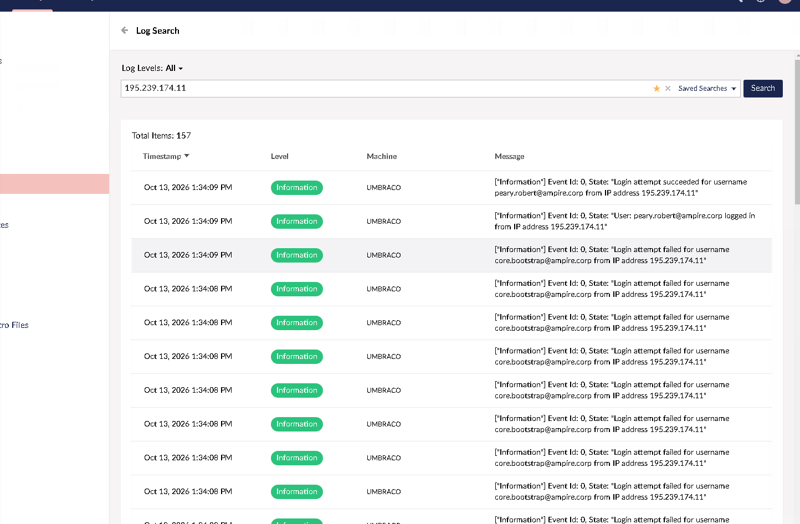

<div align="center">

**РОССИЙСКИЙ УНИВЕРСИТЕТ ДРУЖБЫ НАРОДОВ**

Факультет физико-математических и естественных наук  
Кафедра теории вероятностей и кибербезопасности

<br><br><br>

# ЛАБОРАТОРНАЯ РАБОТА № 3

### на тему

## «Защита сервера веб-приложений»

**38.03.05 — Кибербезопасность в экономике**

<br><br><br>

**Выполнили:**  
Студенты группы НБИбд-01-23

Карпачев Ярослав  
Камалиева Лия  
Дашкина Анита  
Тураева Оиша  
Кузнецова Александра  
Дрожжанова Алена

<br><br><br>

**Москва — 2026**

</div>

---

# Цель работы

Изучить методы обнаружения и расследования компьютерных атак на серверы веб-приложений и связанные с ними узлы корпоративной инфраструктуры, а также получить практические навыки реагирования на инциденты информационной безопасности. В рамках лабораторной работы необходимо исследовать последствия эксплуатации уязвимостей **Umbraco CMS**, **Zerologon** и **Adobe ColdFusion**, устранить признаки компрометации и проверить состояние защищаемых узлов на учебном полигоне **Ampire**.

# Введение. Актуальность

Веб-приложения часто являются точкой входа в корпоративную сеть, поскольку принимают запросы из внешних сегментов. Компрометация приложения может привести к удалённому выполнению кода, созданию посторонних учётных записей, организации скрытых сетевых соединений и дальнейшему перемещению злоумышленника между серверами.

Особенно опасна ситуация, когда атака начинается на веб-сервере, а затем распространяется на контроллер домена Active Directory и сервер приложений в центре обработки данных. В таком случае злоумышленник может получить расширенные полномочия и закрепиться в системе посредством автозагрузки вредоносного кода.

Для обнаружения подобных действий применяются системы мониторинга событий ИБ, средства обнаружения вторжений, журналы операционных систем и средства анализа сетевых соединений. Не менее важен этап реагирования: блокирование скомпрометированных учётных записей, прекращение подозрительных процессов, удаление механизмов закрепления и исправление уязвимых настроек.

В данной работе рассматривается учебный сценарий защиты сервера веб-приложений в формате **Blue Team / CSIRT**.

# Задачи

В ходе выполнения лабораторной работы необходимо:

1. Изучить сетевую инфраструктуру полигона и сценарий атаки.
2. Проанализировать события, связанные с эксплуатацией уязвимости **Umbraco CMS RCE (CVE-2020-9472)**.
3. Выявить и устранить последствия компрометации сервера Umbraco, включая несанкционированные учётные записи и удалённые соединения.
4. Исследовать признаки эксплуатации **Zerologon (CVE-2020-1472)** и механизмы закрепления через автозапуск Windows.
5. Проверить подозрительные процессы, сетевые соединения и связанные с ними родительские процессы.
6. Исправить настройки журналирования **Adobe ColdFusion**, устранить прежнее небезопасное расположение логов и прервать сеанс с нарушителем.
7. Проверить итоговые статусы уязвимостей и последствий в интерфейсе полигона.

# Выполнение лабораторной работы

## 1. Изучение сценария и вектора атаки

Согласно учебному сценарию, нарушитель использует внешний узел с IP-адресом `195.239.174.11` и пытается проникнуть во внутреннюю инфраструктуру организации через веб-приложение. В рассматриваемой топологии выделены следующие основные узлы:

- `10.10.1.26` — сервер веб-приложения **Umbraco** в демилитаризованной зоне (DMZ);
- `10.10.1.25` — **Security Onion**, предназначенный для анализа сетевых событий;
- `10.10.2.10` — контроллер домена **Microsoft Active Directory**;
- `10.10.2.21` — **ViPNet IDS NS**, средство обнаружения атак;
- `10.10.2.40` — сервер приложений **Adobe ColdFusion**.

Сценарий включает три последовательных этапа:

1. **Umbraco CMS RCE.** Подбор либо использование скомпрометированной учётной записи с расширенными полномочиями, эксплуатация возможности установки пакета дополнения и получение доступа к веб-серверу.
2. **Zerologon.** Попытка компрометации контроллера домена посредством CVE-2020-1472 с дальнейшим закреплением вредоносного кода в среде Windows.
3. **Adobe ColdFusion.** Эксплуатация уязвимости десериализации недоверенных данных **CVE-2023-26360**, приводящая к выполнению произвольного кода и появлению вредоносной сессии.

Для расследования использовались сведения из журнала Umbraco, системных журналов Windows, PowerShell, редактора реестра, веб-интерфейса ColdFusion и командной строки Linux. Далее описаны действия, зафиксированные на скриншотах лабораторной работы.

## 2. Анализ событий безопасности в Umbraco

Первым этапом была проверка журнала событий веб-приложения **Umbraco**. В разделе **Log Search** был задан фильтр по IP-адресу предполагаемого нарушителя:

```text
195.239.174.11
```

Поиск возвратил **157 записей**. Среди них присутствуют неудачные попытки входа с именем пользователя `core.bootstrap@ampire.corp`, а также записи об успешном входе пользователя `peary.robert@ampire.corp` с того же IP-адреса.

<div align="center">
 
</div>

Последовательность неудачных попыток аутентификации и последующего успешного входа с подозрительного адреса является основанием для дальнейшего расследования. В контексте рассматриваемого сценария эти события согласуются с попыткой получения доступа к административному интерфейсу CMS.

Учебные материалы также указывают на обнаружение запросов к вредоносной **WebShell** и попыток установки полезной нагрузки. Для анализа таких действий на полигоне используются **Security Onion**, **ViPNet IDS** и журналы **IIS Express**. В материалах отдельно выделено событие `ET TROJAN CMDASP Webshell Command Request` — индикатор подозрительных запросов к веб-оболочке.

## 3. Ограничение полномочий скомпрометированной учётной записи Umbraco

По результатам анализа журнала была открыта карточка пользователя **Robert Peary** (`peary.robert@ampire.corp`). Одним из способов предотвращения повторной эксплуатации уязвимости Umbraco является отзыв избыточных прав у учётной записи и смена её пароля.

В административном интерфейсе **Users** необходимо проверить группы пользователя, убрать опасные разрешения, прежде всего право установки пакетов дополнений **Package editors**, установить новый пароль и сохранить изменения.

На представленном скриншоте у пользователя отображается группа **Editors**, а группа **Package editors** в перечне не показана. Также доступна функция **Change password**. Снимок подтверждает состояние настроек доступа на момент проверки, но не отображает само значение нового пароля.

<div align="center">
<br>
<em>Рисунок 2 — Проверка учётной записи Robert Peary и назначенных ей групп в Umbraco</em>
</div>

Ограничение привилегий непосредственно связано с устранением условий эксплуатации **CVE-2020-9472**. В рассматриваемом сценарии уязвимость позволяет привилегированному пользователю устанавливать пакет дополнения, что может привести к выполнению произвольного кода на сервере.

Дополнительной профилактической мерой является ограничение числа неудачных попыток входа. Такая настройка затрудняет перебор паролей и позволяет быстрее обнаружить подозрительную активность.

## 4. Выявление и удаление посторонней учётной записи Windows

После компрометации веб-сервера нарушитель может закрепиться в операционной системе, создав отдельную локальную учётную запись.

При изучении **Event Viewer** обнаружена запись о создании пользователя с именем `hacker`. В событии указано, что операция выполнена в контексте системы `UMBRACO` домена `AMPIRE`. Это свидетельствует о необходимости проверить наличие несанкционированной учётной записи и удалить её.

<div align="center">
<br>
<em>Рисунок 3 — Системное событие создания локальной учётной записи hacker</em>
</div>

Для проверки локальных пользователей была открыта консоль **Windows PowerShell** с правами администратора. Список учётных записей выведен командой:

```powershell
net users
```

В выводе присутствовала учётная запись `hacker`. Для её удаления была использована команда:

```powershell
net user hacker /delete
```

После удаления повторно выполнена команда `net users`. В обновлённом списке пользователь `hacker` отсутствует; обе команды завершились успешно.

<div align="center">
<br>
<em>Рисунок 4 — Удаление пользователя hacker и повторная проверка списка учётных записей</em>
</div>

Таким образом, была устранена одна из обнаруженных форм закрепления нарушителя на сервере Umbraco.

## 5. Обнаружение и завершение подозрительного сетевого соединения

Для проверки активных соединений и привязанных к ним процессов применялась команда:

```powershell
netstat -bno
```

Параметры команды позволяют вывести сетевые соединения, имена исполняемых файлов и идентификаторы процессов (**PID**). Анализ результата показал установленное TCP-соединение с внешним адресом `195.239.174.11:1085`. Для соответствующего соединения был указан процесс `chisel.exe` с идентификатором **3132**.

Такое соединение является подозрительным в контексте расследуемого инцидента, поскольку связывает защищаемый узел с ранее выявленным адресом нарушителя.

Для принудительного завершения процесса выполнена команда:

```powershell
taskkill /f /pid 3132
```

Система сообщила об успешном завершении процесса. Повторный вывод `netstat -bno` больше не содержал первоначального соединения с `195.239.174.11:1085`.

<div align="center">
<br>
<em>Рисунок 5 — Выявление соединения с нарушителем и завершение процесса chisel.exe</em>
</div>

Результат указывает на прекращение обнаруженного канала удалённого взаимодействия. Однако завершение одного процесса само по себе не исключает его повторного запуска; поэтому дополнительно требуется проверить способы автоматического закрепления.

## 6. Проверка механизмов автозапуска Windows

Вторая часть сценария связана с эксплуатацией **Zerologon (CVE-2020-1472)**. По описанию полигона уязвимость затрагивает механизм аутентификации **Netlogon** и может позволить нарушителю изменить пароль машинной учётной записи контроллера домена. После компрометации возможна установка вредоносной полезной нагрузки, запускаемой повторно.

Для поиска закрепления был открыт редактор реестра Windows. Проверялся раздел:

```text
HKEY_LOCAL_MACHINE\SOFTWARE\Microsoft\Windows\CurrentVersion\Run
```

Этот раздел часто используется для автоматического запуска программ при входе в систему. На скриншоте его правая панель не содержит дополнительных значений автозапуска, кроме стандартного `(Default)`.

Одновременно в каталоге `C:\Windows` обнаружен файл `start` типа **VBScript Script File**. Наличие такого файла в контексте сценария требует проверки его содержимого, происхождения и связей с выполняющимися процессами.

<div align="center">
<br>
<em>Рисунок 6 — Проверка раздела реестра Run и подозрительного VBScript-файла в C:\Windows</em>
</div>

Помимо реестра и файловой системы были проанализированы работающие процессы. В командной строке обнаружен процесс `Connect.exe` с PID **3976**. Первоначальная попытка получить его родительский PID с помощью `wmic` завершилась ошибкой: данная утилита не была доступна в системе.

После этого использована команда PowerShell:

```powershell
Get-CimInstance Win32_Process -Filter "ProcessId = 3976" |
    Select-Object ProcessId, Name, ParentProcessId
```

В результате установлен родительский процесс с PID **1968**. Для его завершения подготовлена команда:

```powershell
taskkill /f /pid 1968
```

На снимке видно определение `ParentProcessId` и ввод команды завершения; отдельного вывода об успешном выполнении этой последней команды на скриншоте нет.

<div align="center">
<br>
<em>Рисунок 7 — Определение родительского PID для Connect.exe средствами PowerShell</em>
</div>

По учебному сценарию для полного устранения последствий **Zerologon** требуется также проверить настройки безопасности контроллера домена: установить соответствующее исправление Windows, пересмотреть предоставленные машинной учётной записи разрешения на запрос репликации и исключить повторную установку полезной нагрузки. Эти действия представлены в методических материалах; отдельные скриншоты их выполнения в предоставленном архиве отсутствуют.

## 7. Проверка конфигурации Adobe ColdFusion

Третий этап инцидента связан с сервером **Adobe ColdFusion** (`10.10.2.40`). В материалах рассматривается уязвимость **CVE-2023-26360**, возникающая при десериализации недоверенных данных и допускающая возможность удалённого выполнения кода.

Для восстановления корректной конфигурации была открыта административная панель **ColdFusion (2021 Release)**, раздел **Debugging & Logging → Logging Settings**. На первом снимке установлен путь сохранения журналов:

```text
/opt/ColdFusion2021/cfusion/logs
```

<div align="center">
<br>
<em>Рисунок 8 — Исходное расположение журналов Adobe ColdFusion</em>
</div>

По условиям учебного сценария необходимо перенести журналы в отдельный каталог внутри `/var/log`, удалить старую директорию и разорвать подозрительную сессию с внешним узлом.

## 8. Создание нового каталога для журналов ColdFusion

Для создания каталога было открыто SSH-подключение к Linux-серверу ColdFusion. Выполнен переход в стандартный каталог журналирования:

```bash
cd /var/log
```

Первая попытка создать папку без повышенных полномочий привела к ошибке `Permission denied`. После этого применена команда с `sudo`:

```bash
sudo mkdir coldfusion
```

Список содержимого `/var/log`, выведенный командой `ls`, подтвердил появление директории `coldfusion`.

<div align="center">
<br>
<em>Рисунок 9 — Создание каталога /var/log/coldfusion с повышенными полномочиями</em>
</div>

Использование каталога `/var/log/coldfusion` позволяет отделить рабочие журналы приложения от его программных файлов и упростить контроль их размещения и разрешений доступа.

## 9. Изменение пути журналирования и перезапуск службы

После создания папки в административном интерфейсе ColdFusion изменён параметр **Log directory**. В качестве нового пути указан:

```text
/var/log/coldfusion/
```

Изменения необходимо сохранить с помощью кнопки **Submit Changes**. В описании настройки отмечено, что для применения нового местоположения журналов требуется перезапуск службы ColdFusion.

<div align="center">
<br>
<em>Рисунок 10 — Указание нового пути хранения журналов ColdFusion</em>
</div>

Перезапуск сервера выполнен из терминала Linux командой:

```bash
sudo /opt/ColdFusion2021/cfusion/bin/coldfusion restart
```

В результате получено сообщение об успешном запуске **ColdFusion 2021 server**. Дополнительно система указала новое расположение выходного журнала:

```text
/var/log/coldfusion/coldfusion-out.log
```

<div align="center">
<br>
<em>Рисунок 11 — Перезапуск ColdFusion и подтверждение нового пути записи журналов</em>
</div>

Таким образом, изменение параметров журналирования было применено, а сервер возобновил работу с новым путём хранения лог-файлов.

## 10. Прекращение вредоносной сессии на сервере ColdFusion

Следующим этапом стала проверка активных сетевых соединений Linux-сервера. Для этого использовалась утилита `ss`:

```bash
sudo ss -tp
```

В выводе выявлено соединение с внешним адресом `195.239.174.11:5560`, связанное с процессом `payload.elf`. Для него указан идентификатор **3255**. Данное соединение соответствует рассматриваемому в сценарии каналу взаимодействия с нарушителем.

Попытка завершить процесс от имени обычного пользователя командой `kill -9 3255` привела к сообщению `Operation not permitted`. Поэтому команда была повторена с повышенными правами:

```bash
sudo kill -9 3255
```

После её выполнения приглашение командной строки вернулось без сообщения об ошибке.

<div align="center">
<br>
<em>Рисунок 12 — Обнаружение соединения процесса payload.elf и завершение PID 3255</em>
</div>

Завершение процесса направлено на разрыв удалённой сессии. Для окончательного подтверждения отсутствия соединения рекомендуется повторно проверить вывод `ss -tp` и сопоставить результат со статусом устранения последствий на полигоне.

## 11. Удаление прежнего каталога журналов ColdFusion

После изменения настроек и перезапуска приложения был удалён старый каталог журналов. В терминале выполнен переход в корневую директорию установки:

```bash
cd /opt/ColdFusion2021/cfusion
```

Обычная попытка удалить файлы из `logs` завершилась отказом в доступе. Удаление выполнено с повышенными правами:

```bash
sudo rm -rf logs
```

Затем произведена проверка содержимого текущей папки:

```bash
ls -la
```

В результатах команды прежний каталог `logs` отсутствует. Важно, что удаление старой папки выполнялось **после** настройки нового пути и успешного перезапуска ColdFusion; в рабочей инфраструктуре перед аналогичной операцией дополнительно требуется удостовериться в наличии резервной копии необходимых журналов.

<div align="center">
<br>
<em>Рисунок 13 — Удаление старого каталога logs и проверка его отсутствия</em>
</div>

В рамках данного сценария удаление прежнего расположения журналов является одним из условий исправления конфигурации сервера ColdFusion.

## 12. Проверка результатов на полигоне Ampire

После выполнения действий по реагированию открыт интерфейс полигона, раздел **«Уязвимости и последствия»**. В нём представлены результаты проверки трёх уязвимостей и трёх связанных последствий:

| Уязвимость / последствие | Статус в интерфейсе |
|---|---|
| Umbraco CMS RCE | **Устранено** |
| Umbraco user | **Устранено** |
| Zerologon | **Устранено** |
| AD VBS autorun | **Устранено** |
| ColdFusion misconfig | **Устранено** |
| ColdFusion meterpreter | **Устранено** |

<div align="center">
<br>
<em>Рисунок 14 — Итоговая проверка: все шесть позиций имеют статус «Устранено»</em>
</div>

Все шесть позиций отмечены зелёным статусом **«Устранено»**. Это подтверждает успешное завершение учебного сценария по критериям проверки полигона.

# Результаты

В ходе лабораторной работы получены следующие результаты:

1. Исследованы схема корпоративной сети и трёхэтапный сценарий компрометации Umbraco, Active Directory и ColdFusion.
2. По журналам Umbraco выявлены подозрительные попытки входа с адреса `195.239.174.11`, включая события успешной аутентификации.
3. Проверены права учётной записи `peary.robert@ampire.corp` и рассмотрены меры ограничения возможности установки пакетов дополнений.
4. По системному журналу Windows обнаружена посторонняя учётная запись `hacker`; её удаление подтверждено повторным выводом `net users`.
5. На сервере Umbraco найдено и прекращено сетевое соединение, связанное с процессом `chisel.exe` (PID 3132).
6. Проверены ключ автозапуска Windows и подозрительный VBScript-файл; для процесса `Connect.exe` найден родительский PID 1968.
7. На сервере ColdFusion создан каталог `/var/log/coldfusion`, изменены настройки журналирования и успешно перезапущена служба.
8. Обнаружена вредоносная сессия процесса `payload.elf` (PID 3255); выполнена команда его принудительного завершения с повышенными правами.
9. Удалён прежний каталог журналов ColdFusion, что подтверждено выводом `ls -la`.
10. Итоговая проверка полигона Ampire показала статус **«Устранено»** для всех трёх уязвимостей и трёх последствий их эксплуатации.

# Заключение

В ходе выполнения лабораторной работы была достигнута поставленная цель: изучены способы выявления компьютерных атак на серверы веб-приложений и отработаны меры реагирования на инциденты в корпоративной инфраструктуре.

Особое внимание уделено анализу журналов CMS Umbraco, контролю учётных записей Windows, выявлению подозрительных сетевых соединений, исследованию процессов и проверке механизмов автозапуска. На сервере Adobe ColdFusion продемонстрированы изменение конфигурации журналирования, перезапуск службы и удаление прежнего каталога лог-файлов.

Работа показала, что успешное реагирование требует не только остановки вредоносного процесса, но и поиска причин его появления и способов повторного запуска. Для повышения защищённости корпоративной инфраструктуры необходимо своевременно устанавливать обновления безопасности, использовать стойкие пароли, ограничивать административные привилегии, контролировать автозагрузку, вести журналы событий и регулярно проверять исходящие соединения.

**Итог:** по результатам проверки на учебном полигоне **Ampire** все предусмотренные сценарием уязвимости и последствия атаки получили статус **«Устранено»**.

---

**Использованные материалы:** методические слайды «Киберучения на полигоне Ampire — Защита сервера веб-приложений» (ЛР3 beta.pdf); скриншоты выполнения из предоставленного архива; оформление и структура отчёта — по образцу «Лабораторная работа № 2. Захват DNS-сервера».

